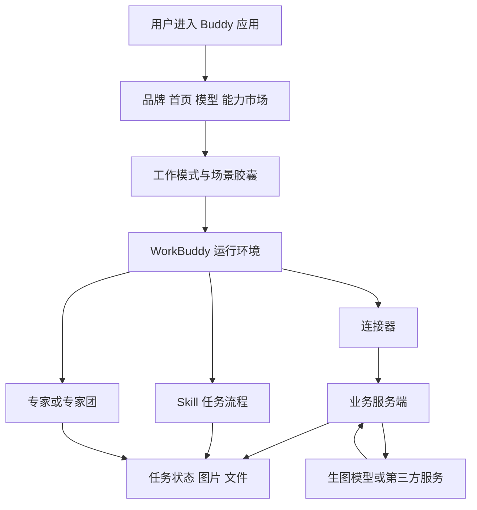

# WorkBuddy 独立应用开发指南

适用范围：在 WorkBuddy 内发布具有独立品牌、场景和能力配置的 Buddy 应用，并按平台支持的方式分发给个人或企业。当前拟开发生图产品，订阅制是候选收费方式，尚未确定最终商品形态及生图额度。

资料核对日期：2026-10-13，Asia/Singapore。开发依据包括官方开放文档、官方模板 ZIP，以及已保存的公开前端代码证据。价格、权限、客户端版本和审核规则可能调整，涉及这些内容时应打开对应官方页面复核。

官方入口：[WorkBuddy 开放平台](https://open.workbuddy.cn/)；可搜索的链接索引：[WORKBUDDY_OFFICIAL_RESOURCES.json](./WORKBUDDY_OFFICIAL_RESOURCES.json)。

## 目录

- [快速查阅](#快速查阅)
- [开发范围与证据规则](#开发范围与证据规则)
- [应用逻辑与职责](#应用逻辑与职责)
- [能力资产与打包规范](#能力资产与打包规范)
- [授权与接口接入](#授权与接口接入)
- [自主定价与订阅](#自主定价与订阅)
- [开发流程与阶段产物](#开发流程与阶段产物)
- [生图应用的业务实现](#生图应用的业务实现)
- [预览与验收](#预览与验收)
- [个人与企业分发](#个人与企业分发)
- [常见问题定位](#常见问题定位)
- [官方资料与模板的差异](#官方资料与模板的差异)
- [项目组织与资料维护](#项目组织与资料维护)
- [官方联系与待确认问题](#官方联系与待确认问题)

## 快速查阅

按当前任务打开相关章节，不必每次重新搜索整个网站。

| 当前任务 | 首选官方资料 | 本地补充 |
| --- | --- | --- |
| 判断可开发哪些能力 | [开放平台概述](https://open.workbuddy.cn/docs/what-is-open-platform) | 应用逻辑与职责 |
| 完成主体认证 | [入驻指南](https://open.workbuddy.cn/docs/onboarding) | 开发流程与阶段产物 |
| 设置开发者展示信息 | [开发者资料](https://open.workbuddy.cn/docs/developer-profile) | 发布前准备 |
| 创建和配置独立应用 | [Buddy 应用](https://open.workbuddy.cn/docs/buddy-app) | 配置模块及分发 |
| 编写技能 | [技能规范](https://open.workbuddy.cn/docs/skill) | Skill 包结构 |
| 编写单个专家 | [专家规范](https://open.workbuddy.cn/docs/expert) | 专家模板及差异 |
| 编写专家团 | [专家团规范](https://open.workbuddy.cn/docs/expert-team) | 主理人配置文件差异 |
| 对接业务 API 或生图服务 | [连接器规范](https://open.workbuddy.cn/docs/connector) | MCP 与 CLI 的选择 |
| 调用 WorkBuddy 的能力 | [第三方应用接入](https://open.workbuddy.cn/docs/third-party-app)、[Open API](https://open.workbuddy.cn/docs/openapi) | 授权方向及权限 |
| 查个人积分读取接口 | [英文 Open API](https://open.workbuddy.cn/en/docs/openapi) | 中英文文档差异 |
| 配置付费与查看收入 | [收入变现后台](https://open.workbuddy.cn/monetization)、[收款账户后台](https://open.workbuddy.cn/monetization/account) | 订阅证据与验证清单；后台需要登录 |
| 分发给指定企业 | [Buddy 应用企业单管理](https://open.workbuddy.cn/docs/buddy-app#企业单管理) | 企业授权生命周期 |
| 查看安装与调用指标 | [运营数据](https://open.workbuddy.cn/docs/operations-data) | 指标解释与业务验收的区别 |
| 查询业务类目要求 | [非个人主体类目](https://open.workbuddy.cn/docs/service-categories-enterprise)、[个人主体类目](https://open.workbuddy.cn/docs/service-categories-individual) | 以实际经营内容选择类目 |
| 处理规范及资质问题 | [法规依据及示例](https://open.workbuddy.cn/docs/legal-basis-and-examples) | 结合适用类目和后台审核反馈 |
| 获取官方支持 | [联系渠道](https://open.workbuddy.cn/docs/contact) | 邮箱与问题提交清单 |

## 开发范围与证据规则

本项目的独立应用运行在 WorkBuddy 中。开发交付包含应用配置和所需的能力资产；需要外部数据或业务计算时，再交付相应服务端。脱离 WorkBuddy 运行的桌面安装包或独立网站属于另外的产品范围。

后续开发使用以下证据分类，尤其适用于收费和权限相关问题。

| 证据类型 | 可以确认什么 | 不能据此确认什么 |
| --- | --- | --- |
| 官方规范 | 文档规定的包结构、字段和接入流程 | 当前账号一定具备该权限，或所有客户端行为一致 |
| 官方模板实际文件 | ZIP 内确实存在的路径、配置和资源 | 模板已满足全部最新字段要求，或能够直接导入成功 |
| 公开前端调用代码 | 前端实际使用的接口路径和参数名 | 服务端鉴权、结算结果、接口对第三方的开放承诺 |
| 页面资源文案 | 界面描述的选项和规则 | 服务端已执行该规则、订阅自动续费或额度自动重置 |
| 服务端及客户端实测 | 指定账号、版本、环境下的实际行为 | 未测试环境中的全部行为 |
| 项目设计 | 我们准备实现的目录、工具和业务规则 | WorkBuddy 已提供同名 API 或同等能力 |

目前没有本项目的应用源码或真实应用配置导出。已有的 `research/` 文件是平台资料核查证据。后续应以真实导出、当前 API 契约及测试结果补齐实现细节，特别是订阅权益与生图服务的关联。

## 应用逻辑与职责

Buddy 应用将品牌、工作模式、场景入口及能力市场组织在同一工作台中。工作模式配置领域规则和绑定 Skill；场景胶囊启动具体任务，并在当前模式上叠加相关能力。模型运行、上下文处理、记忆和工具编排由 WorkBuddy 提供。[官方应用说明](https://open.workbuddy.cn/docs/buddy-app)



该图表示开发者侧的逻辑关系，不是 WorkBuddy 内部部署图。

| 层次 | 我们负责的内容 | 开发时需要取得的实际输入 |
| --- | --- | --- |
| 应用配置 | 名称、品牌、模式、场景、模型选择、能力绑定 | 应用 ID、配置导出、预览入口、目标客户端版本 |
| 业务流程 | 任务步骤、角色规则、输入要求、输出标准 | Skill 或 Agent 定义、可验收样例 |
| 工具接入 | 数据查询、业务操作、任务提交与查询 | MCP 工具定义或 CLI 接口及认证方式 |
| 服务端 | 账号映射、模型调用、任务状态、存储、业务用量 | 我们的服务代码、数据库结构、模型供应商契约 |
| 商业权益 | 平台商品与服务端权益的对应关系 | 当前平台商品类型、付费配置、可用权益接口或其他官方机制 |

官方应用页提到 MCP Apps 集成已有系统，但已读页面没有给出完整的交互组件实现契约。需要自定义界面时，先取得当前客户端支持的协议和示例，再确定界面实现方式。

## 能力资产与打包规范

### 选择交付对象

| 对象 | 用途 | 主要官方资料 |
| --- | --- | --- |
| Buddy 应用 | 组织完整场景和产品入口 | [应用配置](https://open.workbuddy.cn/docs/buddy-app) |
| Skill | 固化可复用任务步骤、参考资料和脚本 | [技能](https://open.workbuddy.cn/docs/skill) |
| 专家 | 固化专业角色、行为与输出要求 | [专家](https://open.workbuddy.cn/docs/expert) |
| 专家团 | 多角色分工及主理人协作 | [专家团](https://open.workbuddy.cn/docs/expert-team) |
| 连接器 | 对接真实业务服务或命令行工具 | [连接器](https://open.workbuddy.cn/docs/connector) |

一个应用不必同时拥有所有对象。选用哪些能力应由场景决定，付费技能和付费专家的商品定价也应分别确认。

### Skill 包

官方结构以 `SKILL.md` 为入口，参考资料、脚本及模板放在相应子目录。

```text
image-workflow/
├── SKILL.md
├── references/
├── scripts/
└── templates/
```

`SKILL.md` 使用 YAML frontmatter 和 Markdown 正文。必填项及触发控制字段以[官方字段表](https://open.workbuddy.cn/docs/skill)为准。以下是自行编写的结构示例，用于说明格式，尚未在 WorkBuddy 中导入验证。

```markdown
---
name: image-brief
description: 整理图片创作需求；用户提出生图需求时使用。
description_zh: 整理主题、用途、尺寸与风格，形成创作需求。
description_en: Turn image requests into a structured creative brief.
version: 1.0.0
author: REPLACE_WITH_AUTHOR
---

# 图片创作需求整理

1. 获取主题、用途、尺寸、风格及参考图要求。
2. 缺少影响结果的参数时向用户补充确认。
3. 输出结构化创作需求，供已接入的生图工具使用。
```

Skill 的触发说明、工具调用方式和异常处理应足够明确。`references/` 中的资料通过正文引用；脚本需要写清命令、参数和运行环境。业务鉴权及用量限制应由服务端执行，Skill 可以说明流程，但不能承担服务端权限校验。

### 专家包

官方专家结构包含 `.codebuddy-plugin/plugin.json`、`agents/` 和头像资源。[专家规范](https://open.workbuddy.cn/docs/expert)

```text
image-expert/
├── .codebuddy-plugin/
│   └── plugin.json
├── agents/
│   └── image-director.md
├── avatars/
│   └── expert.png
└── README.md
```

开发时重点校验 `name`、`expertType`、`agentName`、Agent 文件路径、展示信息和头像引用。官方字段表要求单专家的 `expertType` 为 `agent`，名称与所引用文件应对应；展示标签和快捷提示各固定 3 个，默认初始提示须与第一条快捷提示一致。Agent frontmatter 不允许自行添加 `tools`，工具权限由平台统一分配。

依赖外部工具时可在插件配置中声明 `dependencies.mcpServers` 或 `dependencies.connectors`。专家的 `.mcp.json` 可以附带 `x-workbuddy` 展示及鉴权元信息；它与独立连接器的 `connector-meta.json` 属于不同配置位置。

官方参考包：[design-experts.zip](https://codebuddy-platform-1258344699.cos.ap-beijing.myqcloud.com/open/static/files/design-experts.zip)。实际包内资源缺失和提示词差异见后面的差异登记。

### 专家团包

专家团通过 `expertType: team`、`teamInfo`、成员 Agent 文件和成员展示信息描述团队。主理人负责组织流程和汇总产物；每个成员应有清晰职责。主理人名称须有团队前缀，避免通用名称冲突。[专家团规范](https://open.workbuddy.cn/docs/expert-team)

官方参考包：[trading-team.zip](https://codebuddy-platform-1258344699.cos.ap-beijing.myqcloud.com/open/static/files/trading-team.zip)。主理人设置文件的名称在规范和模板间存在差异，目标客户端导入验证前，不将任一名称当作已经确认的运行契约。

### 连接器包

网络服务优先使用 MCP；已有成熟命令行工具时可使用 CLI。官方按两种业务接入方案分别规定结构。[连接器规范](https://open.workbuddy.cn/docs/connector)

```text
image-connector/
├── connector-meta.json
├── mcp.json              # MCP 方案使用
├── icon.svg
└── skills/
    └── image-service/
        └── SKILL.md
```

CLI 方案使用 `cli.json` 描述安装、认证、状态检查及登出；其元信息应标记为 CLI。独立 MCP 连接器只配置一个 Server。远程生产服务使用 HTTPS；本地进程接入可以使用 stdio。

`source` 应全局唯一；版本号和 `minWorkbuddyVersion` 根据所用字段声明。特别需要复核的兼容点：自填 Token 方案始于 4.23.0；部分多语言及 JSON 状态字段始于 4.24.0；MCP 托管 Node 运行时及 CLI Python 运行时等字段始于 5.0.0。完整字段支持范围以官方版本表为准。

CLI 的登录状态需要跨重启有效。默认认证流程提取 URL 后会终止认证子进程，不能默认让该子进程长期接收回调；若使用 `authWaitForExit` 或 Device Flow，应按对应字段及目标版本验证。

协议与 SDK：[MCP 官方协议](https://modelcontextprotocol.io/)、[TypeScript SDK](https://github.com/modelcontextprotocol/typescript-sdk)、[Python SDK](https://github.com/modelcontextprotocol/python-sdk)。这些入口用于协议实现，不替代 WorkBuddy 的客户端兼容要求。

## 授权与接口接入

### 区分两个授权方向

| 调用方向 | 使用的凭据 | 资料 |
| --- | --- | --- |
| 我们的应用服务端调用 WorkBuddy | WorkBuddy 用户授权产生的 Open API 凭据 | [第三方接入](https://open.workbuddy.cn/docs/third-party-app)、[Open API](https://open.workbuddy.cn/docs/openapi) |
| WorkBuddy 调用我们的 MCP 服务 | 我们业务服务的 OAuth 或用户填写的 Token | [连接器认证](https://open.workbuddy.cn/docs/connector) |

应用 Client ID、应用 Client Secret、WorkBuddy Open API Token 和业务 MCP Token 的用途不同。接入时分别保存其发行方、所属用户、权限范围和生命周期，避免把一种凭据传给另一个服务。

应用服务端调用 Open API 时，由用户授权后换取凭据；申请范围必须落在应用获批的 Scope 中。Client Secret 只在创建时完整展示一次，应由服务端保存。

MCP OAuth 由 WorkBuddy 的公共客户端完成客户端流程，官方要求 OAuth 2.1 与 PKCE，并说明了元数据发现、动态注册、授权及 Token 端点。开发者需要实现并验证服务端端点及回调兼容性。

### 用户填写 Token 的配置

独立连接器使用 `auth_mode: token` 及 `token-schema.json`；字段变量应与 `mcp.json` 的占位符完全一致。文档说明凭据保存在本机并在连接时注入，敏感字段使用密码类型。

专家内置 MCP 的 Token 表单位于 `x-workbuddy.auth.tokenSchema`。它的多语言字段允许对象形式，而独立连接器表单通过 `_en` 平行字段实现多语言。不能因为名称相近就复用同一 JSON 结构。[独立连接器表单](https://open.workbuddy.cn/docs/connector)、[专家内置 MCP](https://open.workbuddy.cn/docs/expert)

### Open API 的使用范围

Open API 涵盖用户资料、本地助理、云端任务、ACP 通道、会话产物及兑换码核销。需要应用从外部驱动 WorkBuddy 时再接入相应接口，不能把它等同于我们生图供应商的 API。[接口总览](https://open.workbuddy.cn/docs/openapi)

| 能力 | 官方文档中的 Scope 示例 | 开发时的确认点 |
| --- | --- | --- |
| 读取用户资料 | `user.profile.readable` | 是否获批、用户是否实际授予 |
| 创建云端任务 | `user.task.invokable` | 任务状态、返回凭据及产物读取方式 |
| 查询云端任务 | `user.task.readable` | 分页、Token 更新及错误响应 |
| 调用本地助理 | `user.localassistant.invokable` | 用户 PC 端在线状态与本地执行行为 |
| 查询本地助理 | `user.localassistant.readable` | 在线及消息接口的实际返回 |
| 发放平台积分 | `user.credit.exchange` | 兑换码核销用途，不作为自定义扣费接口 |

英文文档出现个人积分读取接口及 `user.credit.readable`；中文文档当前相应章节内容不同。应用是否能申请该权限必须结合后台及官方确认，不直接按英文页给全部 Buddy 应用开放该 Scope。

Token 生命周期也存在文档差异：第三方接入页写访问 Token 为 24 小时，Open API 返回示例中 `expires_in` 为 3600。实现使用实际响应中的到期信息，并测试刷新行为，不能硬编码任一示例时长。[差异来源](https://open.workbuddy.cn/docs/third-party-app)、[接口返回字段](https://open.workbuddy.cn/docs/openapi)

## 自主定价与订阅

当前订阅制是候选方案。已经确认公开前端存在付费设置及收入相关调用；尚未取得供外部生图服务验证订阅权益的正式接口契约。

### 已有本地证据

| 证据文件 | 内容 |
| --- | --- |
| [接口代码摘录](./research/workbuddy-subscription/merchant-api.excerpt.js) | 定价设置、改价额度、账户及提现等前端调用 |
| [付费页面资源](./research/workbuddy-subscription/payment-ui.evidence.json) | 按月付费、价格提示、改价限制及购买文案 |
| [收入页面资源](./research/workbuddy-subscription/monetization-ui.evidence.json) | 收款条件与费率相关页面文字 |
| [来源记录](./research/workbuddy-subscription/sources.json) | 原始 URL、原文件摘要及未验证范围 |

页面资源包含按月付费选项，并描述上架后付费方式不可更改、停止续费后失去使用权限；价格提示为 1–9999 元整数。年度改价次数来自动态额度查询。这些是界面层的证据，服务端规则仍需在测试环境确认。

### 前端内部接口观察

| 接口路径 | 已观察到的用途 | 证据性质 |
| --- | --- | --- |
| `POST /api/v2/open-platform/capabilities/{assetId}/pay` | 设置资产付费信息 | `updateGoods` 的调用路径；完整请求模型未确认 |
| `GET /api/v1/open-platform/charge-developer/merchant/goods-price-change-quota` | 查询改价额度 | 参数包含 `partyId`、`resourceId`、`payMode` |
| `GET /api/v1/open-platform/charge-developer/merchant/account` | 查询商户账户 | 已观察到前端请求 |
| `POST /api/v1/open-platform/charge-developer/merchant/withdraw` | 发起提现 | 已观察到前端请求；未执行 |

这些路径来自开放平台前端内部实现，不能视为正式第三方 SDK 契约。不要将开发者后台登录 Cookie 嵌入应用或生图服务；对外集成需要正式获批的接口与凭据。`payMode` 的数值映射未确认，不自行填写猜测值。

### 收入与成本

已保存的收入页面资源标注内测平台服务费 1%，并另有微信支付手续费提示。实际扣费项目、结算周期、退款及税费，以当前协议和实际账单为准，不能直接按售价乘以 99% 当作净利润。

生图产品应分别记录订阅收入、模型调用成本、存储与网络成本及退款。用户买到的是哪些使用权益、计算资源由谁承担，需要在商品说明与已验证的实现中一致。

SkillHub SkillPay 是另一个按次付费服务入口：[官方介绍](https://www.skillhub.cn/skillpay)。它的支付与结算规则不能与 WorkBuddy 市场的买断或包月机制合并使用。本项目尚未选用这条路线。

### 订阅方案必须补齐的验证

| 待确认事项 | 需要取得的证据 | 对开发的影响 |
| --- | --- | --- |
| 收费对象是 Skill、专家还是应用整体 | 当前后台可配置的商品类型及官方说明 | 决定商品与应用的绑定方式 |
| 外部服务端如何验证订阅 | 正式接口、凭据及用户映射说明 | 决定生图接口的授权入口 |
| 到期、续费、退款如何通知 | 回调或查询机制及真实测试结果 | 决定权益更新方式 |
| 是否支持每月图片张数 | 官方额度契约或我们自建用量方案 | 决定套餐容量及重置逻辑 |
| 场景绑定是否保留付费检查 | 未购买、已购买、已到期的客户端实测 | 避免将场景绑定当作权益校验 |
| 企业席位与付费商品如何关联 | 企业版说明及管理员测试结果 | 决定企业用户的服务授权 |

不能仅根据市场显示已购买，或根据客户端传来的资产名称，就让外部生图服务接受付费调用。

## 开发流程与阶段产物

### 场景与收费对象

先列出用户任务、输入、输出、数据来源和可验收结果。生图场景还要记录模型、尺寸、质量、数量、参考图及失败判定。独立应用入口与付费商品分别建模，订阅权益未确认前不写成已经完成的能力。

阶段产物：场景表、验收样例、能力清单、待确认商业接口清单。

### 主体认证与应用创建

按[入驻指南](https://open.workbuddy.cn/docs/onboarding)完成个人或企业主体认证；按[开发者资料规范](https://open.workbuddy.cn/docs/developer-profile)填写对外展示信息。创建 Buddy 应用时准备身份信息、所需授权项、回调地址和可信 Origin。

阶段产物：应用 ID、脱敏基本信息、凭据保管位置、创建审核状态。官方应用流程包含首次创建审核，审核通过后进入草稿配置。

### 开发能力资产

根据选定场景编写 Skill、专家和连接器。网络业务先验证真实 MCP 工具或业务 API，再把调用流程写进 Skill。需要专家团时先验证主理人和成员文件的加载，不直接照搬官方模板的缺失资源。

阶段产物：可解析能力包、版本号、工具契约、正常及异常调用记录。

### 配置应用

开放平台提供身份、首页、市场、其他设置和预览等配置模块。应用配置覆盖工作模式、场景入口、能力列表、模型和绑定文案。[应用配置入口说明](https://open.workbuddy.cn/docs/buddy-app)

保存实际导出 JSON 作为后续修改的基础；已读文档没有完整导出 Schema，不自行发明应用根字段。每次配置变更后重新导出，记录绑定的资产 ID 与版本。

首次内置连接器的应用绑定说明要求 OAuth MCP；同一应用页的其他设置又描述了跳过绑定及非 OAuth 场景。使用 Token 或 CLI 时应验证当前客户端的实际绑定路径，不能直接假定与 OAuth 自动绑定相同。

### 展示素材

应用头像、小图标和市场背景图使用不同规范，准备素材时分别核对。

| 素材 | 当前官方说明 | 规范入口 |
| --- | --- | --- |
| Buddy 应用头像 | 建议 256×256 | [应用配置](https://open.workbuddy.cn/docs/buddy-app) |
| 应用小图标 | 16×16，线宽 1.2px；完整风格要求见设计章节 | [应用设计](https://open.workbuddy.cn/docs/buddy-app#buddy应用设计规范) |
| 精选场景背景 | 1000×910，提供日夜间两套资源 | [应用设计](https://open.workbuddy.cn/docs/buddy-app#buddy应用设计规范) |
| 专家及专家团头像 | 512×512，PNG 或 JPG，单张不超过 500KB | [专家头像](https://open.workbuddy.cn/docs/expert) |
| 连接器图标 | 推荐 SVG；PNG 或 JPG 建议 64×64 | [连接器图标](https://open.workbuddy.cn/docs/connector) |

### 预览与商业验证

使用官方预览入口和对应 WorkBuddy 客户端验证完整场景。拟付费发布时，再根据当前收款后台完成商品配置及交易测试。

阶段产物：客户端版本、配置版本、目标资产版本、订阅测试结果及已知限制。

### 提交与维护

应用完成配置审核后发布；发布后的配置变更需要重新提交审核。连接器和能力包的版本也应独立记录。[应用发布](https://open.workbuddy.cn/docs/buddy-app)、[连接器提交](https://open.workbuddy.cn/docs/connector)

发布记录至少包含应用 ID、各资产 ID、版本、最低客户端版本、分发范围、接口版本和已知问题。保存上次可用配置，并确认后台支持的恢复方式后再制定回退流程。

## 生图应用的业务实现

以下内容是本项目的实现要求，不是 WorkBuddy 已提供的生图 SDK。

### 业务服务边界

如果接入我们购买的模型 API，服务端负责模型密钥、任务创建、结果查询、图片存储和用量统计。先取得模型供应商的真实请求、返回与计费契约，再确定代码接口。

| 业务模块 | 需要实现或确认的内容 |
| --- | --- |
| 用户映射 | 将已认证业务身份与平台可验证身份关联；所用标识的作用域明确 |
| 订阅权益 | 可验证的有效期、商品及套餐；不得靠用户自行提交的付费状态 |
| 任务管理 | 唯一任务编号、状态、生成参数、供应商任务编号及结果 |
| 重试处理 | 同一任务的重试复用已有结果或继续查询，防止重复生成和重复记账 |
| 用量统计 | 若套餐限制张数，记录实际业务计量及周期；它不等于平台积分余额 |
| 结果交付 | 图片可访问期限、下载、归属、生成记录和失败说明 |
| 成本记录 | 每次任务对应的供应商成本、成功数量与退款处理结果 |

单次 MCP 请求的响应时间需要考虑官方建议。耗时生图可采用任务提交和状态查询的业务设计，具体工具名称与返回结构由我们的服务契约确定；这些名称不属于 WorkBuddy 官方 API。

### 必须先做出的产品决定

- 月费包含的是不限次使用资格，还是明确数量的图片额度。
- 使用平台内已接入模型，还是我们的外部模型服务；资源费用分别由谁承担。
- 多张任务按请求数量、成功数量还是其他单位计量。
- 失败、部分成功、主动取消和退款后，用量如何处理。
- 月份采用自然月还是订阅周期，何时开始和结束。
- 用户到期后能否查询或下载此前图片。

当前不假设平台会替外部生图服务完成上述计量与权益同步。

## 预览与验收

### 基础能力

| 检查项 | 验收依据 |
| --- | --- |
| 包可解析 | 客户端或开放平台成功识别实际 ZIP |
| 引用完整 | Agent、Skill、头像和资料路径全部存在 |
| 模式与场景有效 | 从实际入口启动，观察绑定能力及结果 |
| 工具可用 | 用户身份明确，正常查询或生成能完成 |
| 认证恢复 | 重启、Token 更新、撤销及重新连接行为已验证 |
| 失败可定位 | 超时、参数错误及供应商失败有稳定的错误结果 |
| 版本兼容 | 最低目标客户端上验证所用配置字段 |

### 订阅与生图

| 用户或任务状态 | 要验证的结果 |
| --- | --- |
| 从未购买 | 平台入口与业务服务端的访问行为符合商品规则 |
| 已购买且有效 | 用户映射正确，允许约定的生成能力 |
| 到期或取消续费 | 实际何时失效；外部服务是否同步失效 |
| 续费或重新购买 | 有效期及已有用量如何更新 |
| 退款 | 权益和任务记录如何处理 |
| 同一请求被重试 | 不重复创建任务，不重复记账 |
| 部分图片失败 | 成功数量、结果交付及用量一致 |
| 多端同时提交 | 用量及身份校验不会因并发绕过 |

测试记录使用脱敏数据，注明日期、账号类型、客户端版本、应用及资产版本。涉及真实购买或提现的验证需要使用获授权的测试交易流程。

### 运营数据的含义

官方运营数据按 T+1 更新。技能及专家的调用量以定义文件读取计数，连接器以工具使用计数；这些指标不直接表示成功生成了多少张图片。生图成功数和订阅用量需要由业务任务记录提供。[官方指标口径](https://open.workbuddy.cn/docs/operations-data)

## 个人与企业分发

### 个人用户

开发者主页可以展示已发布能力，用户按平台提供的入口查看或使用。[开发者主页](https://open.workbuddy.cn/docs/developer-profile)

Buddy 应用的具体个人分发入口、付费资产绑定后的购买动线及可见范围，需要在真实发布或预览后台确认。预览链接用于验证配置，不直接当作正式发布链接交付。

### 指定企业

应用上架并选择发布到企业后，通过企业单授权给已购买企业版 WorkBuddy 的目标企业。开发者创建企业单，企业管理员确认授权，再按全员制或席位制分配员工。[企业单说明](https://open.workbuddy.cn/docs/buddy-app#企业单管理)

创建前取得企业 ID、名称、联系人及约定的授权模式和时长。当前官方文档列出的时长为 3 个月、半年或 1 年，并暂时限制同一应用向同一企业创建一次企业单。再次授权或续期方案需要先确认现行平台能力。

| 企业单状态 | 当前文档描述的行为 |
| --- | --- |
| 待确认授权 | 可以取消；管理员确认后生效 |
| 已生效 | 应用进入企业管理后台，管理员分配使用 |
| 待确认终止 | 开发者发起终止后等待管理员确认 |
| 已终止 | 管理员确认终止或授权到期后结束 |
| 已取消 | 授权链接失效 |

企业单的席位和使用时长不自动证明外部生图服务已取得企业员工的订阅权限，两者的关联仍需接入说明与实测。

## 常见问题定位

| 问题 | 先检查什么 | 查阅入口 |
| --- | --- | --- |
| Skill ZIP 解析失败 | 入口文件、YAML、必填字段、压缩层级及引用路径 | [技能](https://open.workbuddy.cn/docs/skill) |
| 专家加载失败 | `plugin.json`、Agent 文件名、`agentName`、双语信息及依赖 | [专家](https://open.workbuddy.cn/docs/expert) |
| 专家团主理人未加载 | 团队 Agent 对应关系及设置文件名的实际解析行为 | [专家团](https://open.workbuddy.cn/docs/expert-team)、模板差异 |
| 头像或资源不显示 | 文件是否存在、相对路径基准、格式与体积 | 对应资产规范 |
| MCP OAuth 授权失败 | 元数据、动态注册响应、PKCE、回调地址及 Token 响应 | [连接器](https://open.workbuddy.cn/docs/connector) |
| Token 表单不能渲染 | 独立连接器与专家内置表单格式是否混用，最低版本是否满足 | 连接器及专家规范 |
| 低版本看不到连接器 | `minWorkbuddyVersion` 与实际字段版本 | 连接器版本表 |
| CLI 重启后未登录 | 凭据持久化、`status` 判定及安装环境 | CLI 认证说明 |
| 应用入口没有预期能力 | 当前导出配置、资产 ID、发布范围和客户端版本 | [Buddy 应用](https://open.workbuddy.cn/docs/buddy-app) |
| 订阅配置或改价失败 | 当前商户状态、资产商品类型、改价额度及实际错误响应 | 收入变现后台及本地证据 |
| 显示已购买但外部服务拒绝 | 已验证的用户映射、服务端权益来源及到期信息 | 正式业务授权契约 |
| 调用量与生成图片数不一致 | 指标计数单位及业务任务结果 | [运营数据](https://open.workbuddy.cn/docs/operations-data) |

没有规范依据时，先收集脱敏错误响应和最小复现，不通过不断尝试参数值来推断商业接口契约。

## 官方资料与模板的差异

两个官方 ZIP 已按实际条目检查，未执行包内脚本。记录见[模板检查证据](./research/workbuddy-templates/official-template-inspection.json)。

| 差异 | 实际观察 | 开发处理 |
| --- | --- | --- |
| 专家团设置文件名 | 文档目录为 `settings.json`，ZIP 为 `trading-team/setting.json` | 使用目标客户端导入或取得官方确认后确定文件名 |
| 单专家头像缺失 | ZIP 配置引用 `avatars/expert.png`，该条目不在包中 | 提供符合规范的头像并验证引用 |
| 专家团头像缺失 | 配置引用的团队及成员头像共 14 个路径，均不在 ZIP 中 | 补全素材，不将模板视为完整发布包 |
| 初始提示词不一致 | 两个 ZIP 的默认初始提示与第一条快捷提示不同；文档要求一致 | 按当前字段要求整理，再进行解析验证 |
| Token 时长说明不同 | 接入页写 24 小时，Token 示例为 3600 秒 | 采用实际 `expires_in` 并测试刷新 |
| 中英文接口内容不同 | 英文页包含个人积分读取接口，中文相应章节不同 | 以获批权限、当前正式契约及接口结果确认 |

本地记录描述 2026-10-13 下载版本；官方替换 ZIP 或文档后，应重新下载并检查。

## 项目组织与资料维护

### 后续代码目录建议

以下是项目组织建议，目前只创建了指南、链接索引和 `research/` 证据。

```text
workbuddy/
├── WORKBUDDY_DEVELOPMENT_GUIDE.md
├── WORKBUDDY_OFFICIAL_RESOURCES.json
├── research/
│   ├── workbuddy-subscription/
│   └── workbuddy-templates/
├── app-config/             # 后续保存实际导出及版本记录
├── assets/                 # 后续开发可分发能力包
│   ├── skills/
│   ├── experts/
│   └── connectors/
├── service/                # 按选定技术栈实现业务后端
└── docs/                   # 接口契约 场景样例 版本记录
```

`app-config/` 仅保存脱敏后的导出；真实密钥进入专门的服务配置或密钥管理位置。压缩发布包应检查 `.codebuddy-plugin/` 等隐藏目录完整性，并移除无关缓存、日志和系统文件。

### 每次开发的资料读取顺序

1. 在本指南的快速查阅表定位当前任务。
2. 打开对应官方章节，复核涉及的字段、版本和当前规则。
3. 读取相关本地证据、实际应用导出和项目接口契约。
4. 发现冲突时记录证据和影响；不能确认的行为保留为待验证项。
5. 完成实现后保存脱敏验收结果及版本记录。

CLI 中可以直接搜索索引及证据，避免重新检索网页：

```powershell
rg -n '订阅|payMode|monthly|鉴权' WORKBUDDY_DEVELOPMENT_GUIDE.md research
rg -n 'buddy-app|expert-team|connector|template' WORKBUDDY_OFFICIAL_RESOURCES.json
```

### 更新触发条件

- 修改应用配置或能力绑定：重新导出并记录配置版本。
- 使用新的客户端字段：复核最低版本并增加目标版本验收。
- 开始收费、改价或调整商品：复核协议、后台选项及结算说明。
- 更新模型供应商：复核生成参数、费用与失败结果。
- 下载新的官方模板：重新检查文件、引用及规范差异。
- 获得订阅权益接口或测试结果：更新订阅待确认表和接口契约。

索引中的核对日期是资料检查日期，不是官方发布日期，也不表示已经建立自动监控。

## 官方联系与待确认问题

官方邮箱：[openworkbuddy@tencent.com](mailto:openworkbuddy@tencent.com)。社群入口见[官方联系页](https://open.workbuddy.cn/docs/contact)。

生图订阅开发需要优先确认：

1. Buddy 应用整体能否作为独立订阅商品，还是需要绑定付费 Skill 或专家。
2. 外部服务端可使用哪种正式机制验证已购买、有效期、退款和续费。
3. 该机制支持什么用户标识、权限范围、回调或查询频率。
4. 平台是否支持每月图片额度；若不支持，自建业务用量与平台商品如何关联。
5. 应用场景直接绑定付费资产时，客户端如何执行购买与到期检查。
6. 企业单授权、员工席位与个人付费商品的关系。
7. 模板设置文件名差异及缺失资源的当前正确处理方式。

提交问题时附应用或资产 ID、账号主体类型、客户端版本、脱敏配置、完整错误码与最小复现步骤。无需提供 Client Secret、用户 Token、后台 Cookie 或生图供应商密钥。
